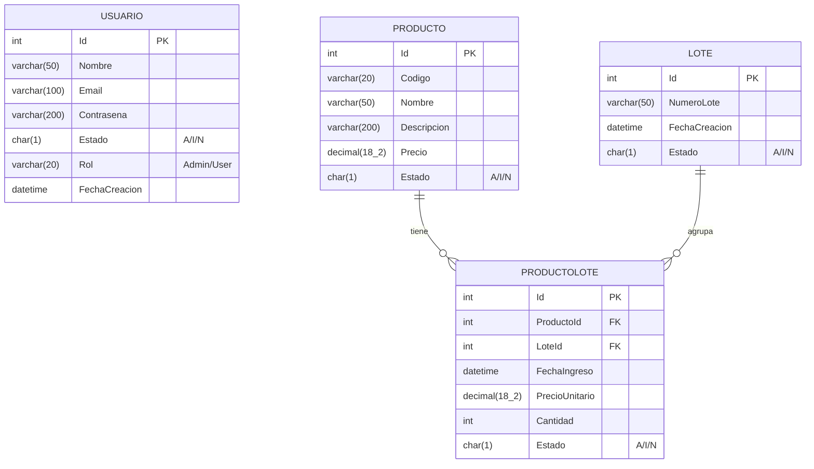

# Sistema de Inventario Full Stack

Aplicación full stack para gestión de inventario con autenticación JWT, manejo de productos, lotes y entradas por lote.

## Stack

- **Frontend**: Angular 22, Angular Material, Bootstrap, SSR habilitado.
- **Backend**: .NET 10 Web API, arquitectura por capas, JWT, Serilog, Swagger.
- **Base de datos**: SQL Server / LocalDB (`G_Inventario`).

## Estructura del proyecto

```text
SistemaInventario-FullStack/
├── ProyectoInventario_backend/      # API .NET
│   ├── Database/
│   │   └── 01_schema.sql            # Crea BD, tablas, restricciones y datos seed
│   ├── Presentation/
│   ├── Application/
│   ├── Domain/
│   ├── Infrastructure/
│   └── appsettings.json
├── ProyectoInventario_fronted/      # Aplicación Angular
└── README.md
```

## Requisitos previos

- [.NET SDK 10](https://dotnet.microsoft.com/) (el proyecto backend apunta a `net10.0`).
- [Node.js](https://nodejs.org/) 22+ y npm (o Bun, según prefieras).
- SQL Server LocalDB, SQL Server Express o SQL Server.
- Opcional: SSMS o Azure Data Studio para ejecutar el script SQL.

## 1. Crear la base de datos

El script principal se encuentra en:

- `ProyectoInventario_backend/Database/01_schema.sql`

Este script:

- Elimina la base `G_Inventario` si ya existe.
- Crea la base `G_Inventario`.
- Crea tablas: `Usuario`, `Producto`, `Lote`, `ProductoLote`.
- Crea restricciones `CHECK`, claves primarias y foráneas.
- Inserta datos seed iniciales.

### Opción A: SQL Server Management Studio / Azure Data Studio

1. Abre `ProyectoInventario_backend/Database/01_schema.sql`.
2. Conéctate a tu instancia SQL Server/LocalDB.
3. Ejecuta el script completo.

### Opción B: sqlcmd

Desde la raíz del repositorio:

```powershell
sqlcmd -S "(localdb)\MSSQLLocalDB" -i "ProyectoInventario_backend\Database\01_schema.sql"
```

> Si usas otra instancia SQL Server, cambia el valor de `-S` por tu servidor.

## 2. Configurar el backend

Revisa `ProyectoInventario_backend/appsettings.json`:

```json
"ConnectionStrings": {
  "BaseConexion": "..."
},
"Jwt": {
  "Key": "...",
  "Issuer": "ProyectoInventario",
  "Audience": "ProyectoInventarioClients",
  "ExpiresInMinutes": "60"
}
```

- Ajusta `ConnectionStrings:BaseConexion` a tu instancia SQL.
- La configuración JWT incluida sirve para desarrollo local. Para otro entorno, cambia la clave por una segura.

### CORS

El backend permite por defecto el origen:

- `http://localhost:4200`

Si cambias el puerto del frontend, actualiza la política CORS en `ProyectoInventario_backend/Program.cs`.

## 3. Ejecutar el backend

Desde la raíz del repositorio:

```powershell
cd ProyectoInventario_backend
dotnet restore
dotnet run
```

URLs por defecto (según `launchSettings.json`):

- HTTP: `http://localhost:5299`
- HTTPS: `https://localhost:7167`
- Swagger (Development): `http://localhost:5299/swagger`

## 4. Ejecutar el frontend

En otra terminal, desde la raíz del repositorio:

```powershell
cd ProyectoInventario_fronted
npm install
npm start
```

La aplicación Angular quedará disponible normalmente en:

- `http://localhost:4200`

> El frontend consume la API configurada en sus servicios; asegúrate de que el backend esté corriendo antes de usar la aplicación.

## Orden recomendado de ejecución

1. Ejecutar `01_schema.sql` para crear la base y cargar datos iniciales.
2. Verificar la cadena de conexión en `appsettings.json`.
3. Levantar el backend con `dotnet run`.
4. Confirmar que Swagger responde en `http://localhost:5299/swagger`.
5. Levantar el frontend con `npm start`.
6. Abrir `http://localhost:4200` e iniciar sesión.

## Credenciales seed

El script crea un usuario inicial:

- **Email**: `carlos@inventario.com`
- **Contraseña**: `Admin123!`
- **Rol**: `Admin`

## Funcionalidades principales

- Autenticación con JWT.
- Gestión de productos.
- Gestión de lotes.
- Registro de entradas por lote (`ProductoLote`).
- Eliminación lógica mediante `Estado`:
  - `A`: Activo
  - `I`: Inactivo
  - `N`: Eliminado
- Logs con Serilog en consola y archivo diario `Logs/log-.txt`.
- Middleware de logging de tramas HTTP entrantes/salientes para rutas `/api`.
- Manejo centralizado de errores con respuesta estándar.

## Diagrama de base de datos (Mermaid)



## Notas

- El script `01_schema.sql` recrea la base de datos completa; ejecutarlo borra datos existentes de `G_Inventario`.
- Los logs del backend se escriben en consola y en `ProyectoInventario_backend/Logs/log-.txt` (rolling diario).
- El middleware de tramas HTTP registra request/response de `/api` y redacta campos sensibles como contraseñas/tokens.
- Si el backend está en ejecución, reinícialo después de cambios de código para evitar bloqueos de compilación por archivos en uso.